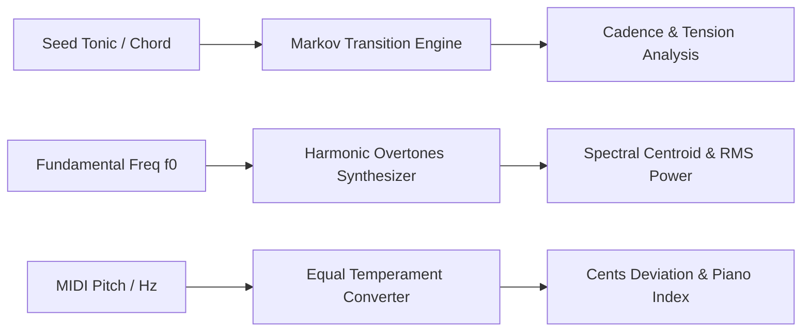

# openclaw-genpark-music-creator


OpenClaw GenPark Music Creator is a zero-dependency audio synthesis and compositional toolkit implementing discrete Fourier harmonic overtone modeling, equal-temperament microtonal MIDI conversion, and functional diatonic Markov chain chord progression generation.



## Features
- **Harmonic Overtone Synthesis**: Computes exact harmonic series $f_k = (k+1)f_0$, spectral centroid, and crest factor.
- **Microtonal Pitch Conversion**: Bidirectional conversion between standard MIDI integers/floats and acoustic frequency $f = 440 \cdot 2^{(m-69)/12}$ with cents deviation.
- **Markov Diatonic Harmony**: Generates functional chord sequences with tonic, subdominant, and dominant tension metrics.

## Quickstart

```python
from client import OpenClawGenParkMusicCreator

creator = OpenClawGenParkMusicCreator()
progression = creator.generate_markov_chord_progression(seed_chord="I", length=8)
for chord in progression["chords"]:
    print(chord["bar"], chord["chord_symbol"], chord["harmonic_function"])
```

## License
MIT
